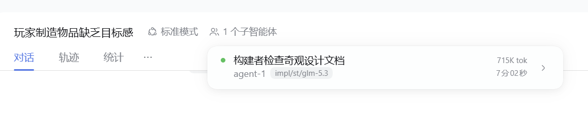
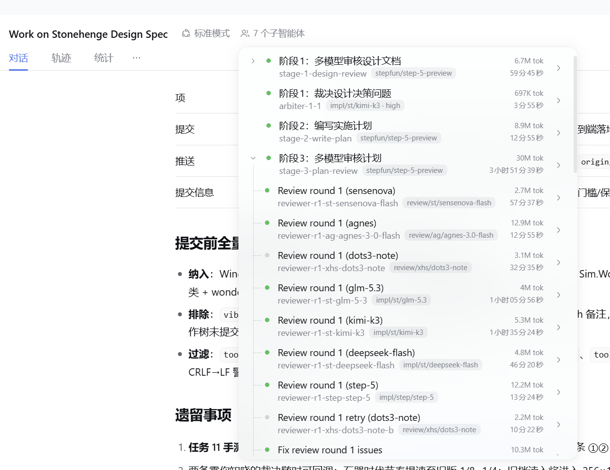
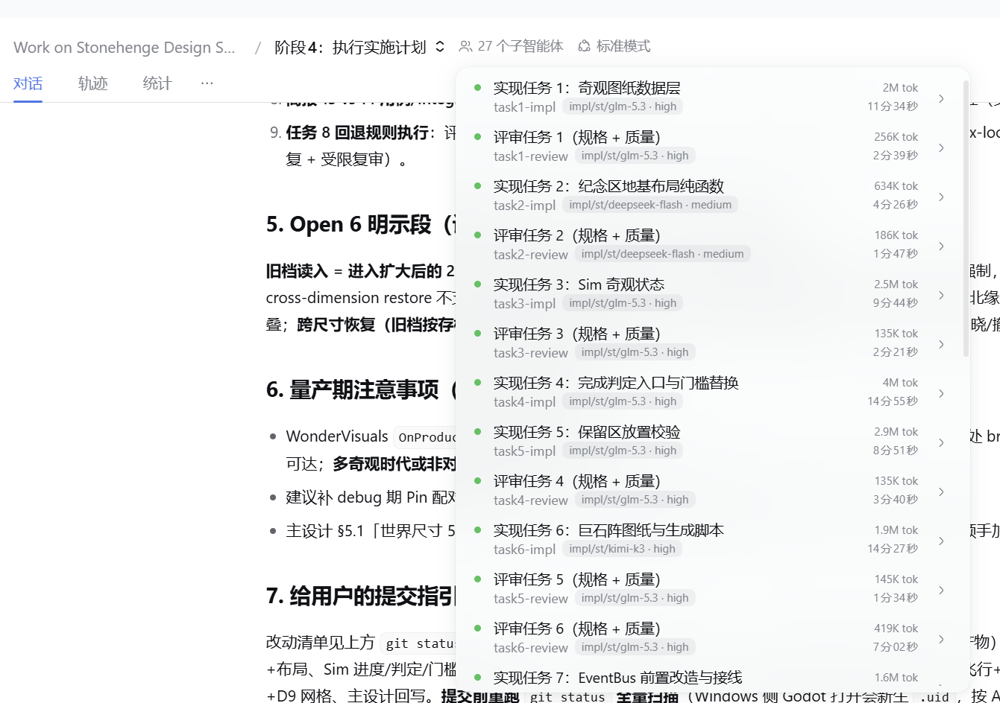

# dsh-subagent-model-tags

[](https://github.com/rolfhu/dsh-subagent-model-tags/actions/workflows/ci.yml)

English | [中文](README.zh.md)

A DeepSeek Harness plugin that shows each subagent's model name in the session-header subagent panels, and widens those panels from 360 px to 460 px.

## Screenshots

The model name appears on the row's name line — the second line when the row shows a description:



Every nesting level carries its own model name, including provider and reasoning effort:



Inside a subagent conversation, the breadcrumb panel shows model names too:



## What it does

- Adds each subagent's model name on its row's name line in every subagent panel: the root session's subagent panel, a subagent conversation's sibling switcher, and its own children panel. The name is written as `provider/model · reasoning effort`, at every nesting level.
- A subagent with no recorded model, and external subagents that have no local session, show `—`.
- Widens the subagent panels to 460 px (still bounded by the window width).

The model name comes from each subagent session's `modelSelection` projection, which the Harness records durably, so it shows what the subagent actually runs with rather than what a parent was asked for.

## Install

Requires DeepSeek Harness `0.2.2-rc.4` and later `0.2.x`.

- **Published package**: open **Plugins** in the Web sidebar, choose **Add plugin**, and enter `@hukj/dsh-subagent-model-tags`. The Plugin Manager picks the registry through its own configuration and falls back through the configured registries.
- **Local development**: enter the absolute path of this directory in the same dialog.

Then enable the bundle if it is switched off. The change takes effect after a page refresh.

## Limitations

- The model name is injected as text into the panel's rendered rows, so a future DSH panel change can silently stop it. The plugin writes a name onto a row only when it can pair every rendered row against a catalog it knows (the conversation's own or an ancestor's) and verify each paired row's displayed label; a panel that verifies against nothing stays untouched instead of showing a wrong model.
- Two catalogs with identical row labels in the same order could still cross-match; in practice that requires two identical agent sets on the same chain.
- The panel width is raised through the host's `--dsh-subagent-menu-width` variable; if the host restructures the panel, the width rule may stop applying.
- Diagnostics: with a panel open, run `__subagentModelsDebug()` in the page console to see what the last syncs paired and why a candidate root was rejected.

## Files

| File | Role |
|---|---|
| `client.js` | Web client module: panel widening and the two invisible seats that write model names |
| `index.js` | Inert Host entry |
| `cordis.patch.yml` | Bundle patch inserting the plugin row |
| `locale/*.json` | Plugin display metadata in eight languages |
| `docs/DETAIL.md`, `docs/preview.svg` | Detail page image |
| `docs/images/*.png` | README screenshots |
| `screenshots.json` | Screenshot list for plugin storefronts |
| `assets/icon-180.png` | Raster icon for plugin storefronts |
| `icon.svg` | Plugin icon |

## Development

The self-check loads the client module with a stub module loader, runs its factory, exercises both slot registrations, renders both components, and executes the effect bodies against a minimal fake DOM — including a panel sync where an equal-count wrong catalog root must be rejected by label verification.

```sh
node test/selftest.cjs
```

It is not part of the published package.

## Releasing

Publishing is automated: pushing a version tag runs the `Release` workflow, which checks that the tag matches `package.json`, runs the self-check, and publishes to npm.

```sh
# 1. bump the version in package.json and commit it
# 2. tag and push
git tag v1.0.1
git push origin v1.0.1
```

The workflow needs the `NPM_TOKEN` repository secret: an npm token that may publish `@hukj` and may bypass 2FA (an "Automation" token or a granular token with publish access). With npm Trusted Publishing configured for this repository, the secret can be removed and the workflow publishes over OIDC instead. `CI` runs the self-check on every push to `main` and on pull requests.

## License

MIT
