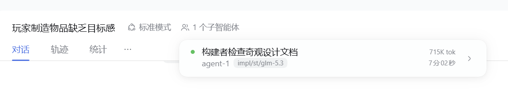
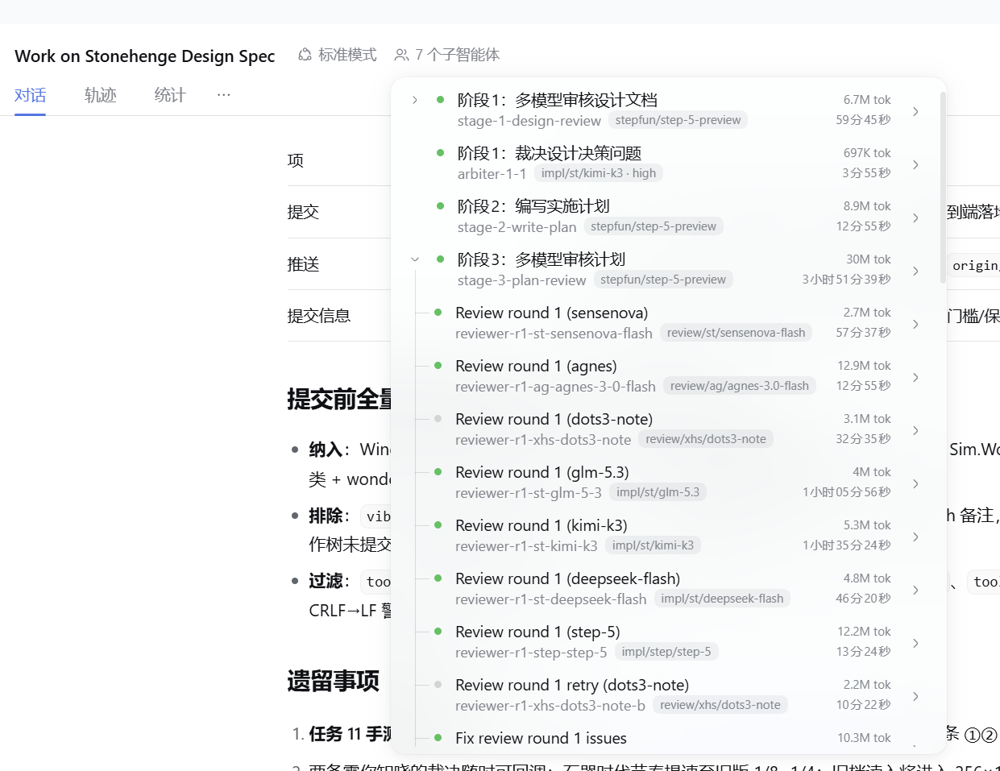
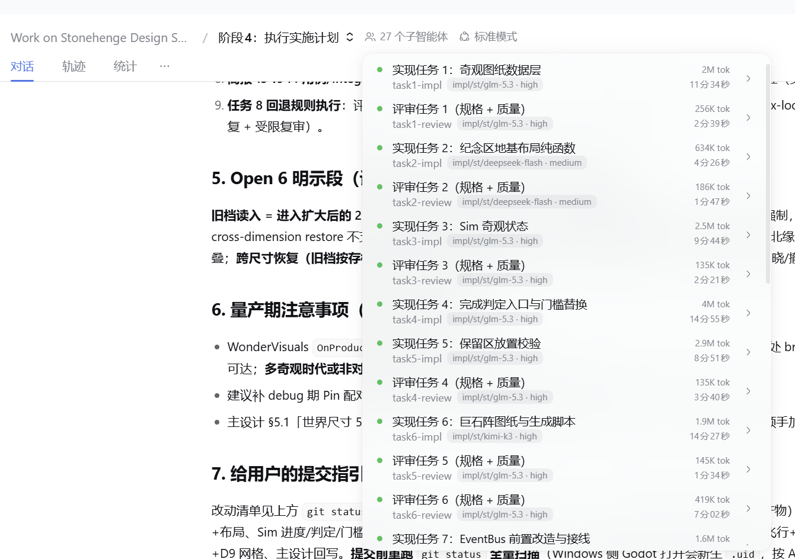

# dsh-subagent-model-tags

[](https://github.com/rolfhu/dsh-subagent-model-tags/actions/workflows/ci.yml)

[English](README.md) | 中文

一个 DeepSeek Harness 插件：在会话顶部的子代理面板里显示每个子代理所使用的模型名，并把面板宽度从 360px 加宽到 460px。

## 效果展示

模型名显示在行的名称行上（有描述的行就是第二行）：



每一层嵌套都带自己的模型名，包含 provider 与推理档位：



进入子代理会话后，面包屑面板同样显示模型名：



## 功能说明

- 在会话顶部的各子代理面板中，为每个子代理的名称行追加模型名：根会话的子代理面板、子代理会话的兄弟切换面板、以及它自己的子代理面板，所有嵌套层级都生效。模型名格式为 `provider/model · 推理档位`。
- 没有任何模型记录的子代理、以及没有本地会话的 external 子代理显示 `—`。
- 把子代理面板加宽到 460px（仍受窗口宽度限制）。

模型名取自每个子代理会话的 `modelSelection` 投影（Harness 会持久记录），因此显示的是子代理实际使用的模型，而不是父会话「要求」的模型。

## 安装

要求 DeepSeek Harness `0.2.2-rc.1` 及之后的 `0.2.x` 版本。

- **已发布版本**：在 Web 侧边栏打开 **Plugins**，选择 **Add plugin**，输入 `@hukj/dsh-subagent-model-tags`。管理器会先按自身配置的 registry 查询，失败再按配置的回退 registry 依次尝试。
- **本地开发**：在同一个对话框里输入本目录的绝对路径。

若插件被关闭，请在列表里启用它。改动需要刷新页面后生效。

## 已知限制

- 模型名是以文本形式注入到面板已渲染的行里的，因此 DSH 未来改动面板结构时可能悄悄失效。插件只会在「能把面板每一行与已知目录（当前会话或某个祖先会话的目录）完整配对，且每行显示名与条目期望名逐一匹配」时才写入模型名；无法校验通过的面板宁可不显示，也不显示错误的模型。
- 两个目录层级的显示名序列完全相同时仍可能交叉配对；实际上要求同一条链上存在两组完全相同的子代理。
- 面板宽度通过宿主 `--dsh-subagent-menu-width` 变量提升；宿主重构面板时宽度规则可能失效。
- 调试方法：面板打开时在浏览器控制台执行 `__subagentModelsDebug()`，可以看到最近一次同步配对了什么、候选根为什么被拒绝。

## 文件说明

| 文件 | 作用 |
|---|---|
| `client.js` | Web 客户端模块：面板加宽与两个写入模型名的隐形座位 |
| `index.js` | 空的 Host 入口 |
| `cordis.patch.yml` | 插入插件行的 bundle 补丁 |
| `locale/*.json` | 八种语言的插件展示元数据 |
| `docs/DETAIL.md`、`docs/preview.svg` | 详情页图片 |
| `docs/images/*.png` | README 截图 |
| `screenshots.json` | 插件市场用的截图清单 |
| `assets/icon-180.png` | 插件市场用的位图图标 |
| `icon.svg` | 插件图标 |

## 开发

自检脚本会用桩模块加载器加载客户端模块、执行工厂、检查两个槽位注册、渲染两个组件，并用一个极简假 DOM 执行 effect 主体——其中包括一个「行数相同但目录根错误」的面板同步场景，必须被名称校验拒绝。

```sh
node test/selftest.cjs
```

该脚本不参与 npm 发布包。

## 发布

发布全自动，**版本标签是唯一版本来源**。两个入口，同一条流水线：

- **Releases 页（推荐）**：Releases → Draft a new release → 标签填 `vX.Y.Z` → Publish release
- **Actions 页**：Actions → Release → Run workflow → 输版本号，或**留空自动 patch +1**（tag 和 Release 由工作流自己创建）

无论哪个入口，工作流都会：把该版本写进 `package.json`、提交 bump 到 `main`、把 tag 移到该提交上（**tag 指向的树与发布物完全一致**，与 `npm version` 形态相同）、跑自检，然后通过 Trusted Publishing（OIDC，不存令牌、无需批准）直接发布到 npm 并附带 provenance。比已发布版本旧的版本会被拒绝；已发布的版本会跳过。

不需要在本地改版本号——tag 就是版本。工作流的 trusted-publisher 连接允许的是直接 `npm publish`。如果连接只允许 `npm stage publish`（2026-09-03 之后创建的连接默认如此），发布会以 `403 OIDC permission denied` 失败——连接不能编辑，只能删除重建并显式选择直接发布。`CI` 工作流会在每次推送到 `main` 和每个 PR 上跑自检。

[RELEASING.md](RELEASING.md) 记录了 npm 账号状态、trusted-publisher 配置和插件市场投稿的完整操作手册，供以后的发布使用。

## 许可证

MIT
